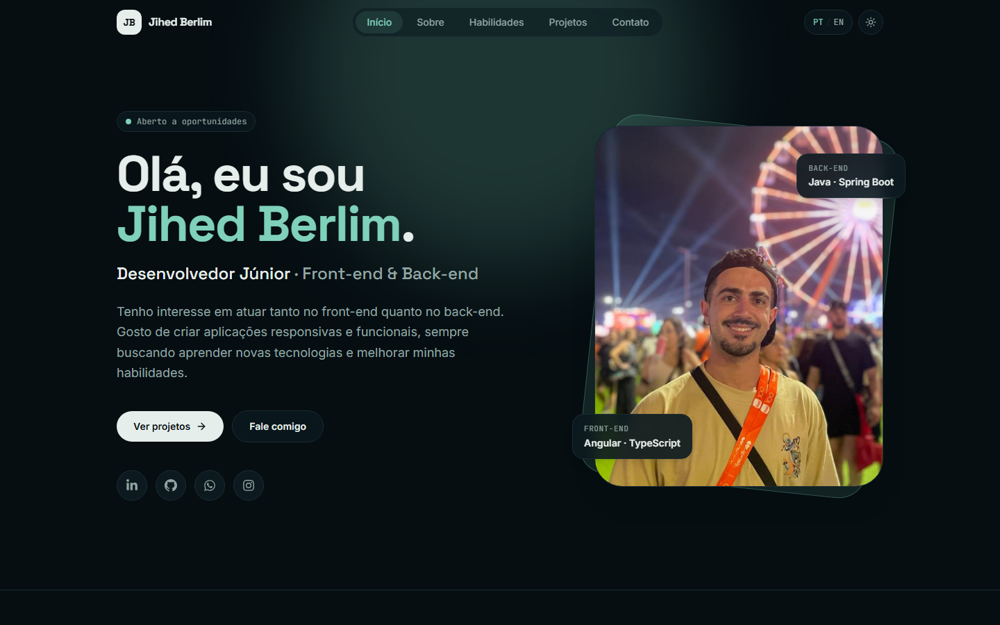
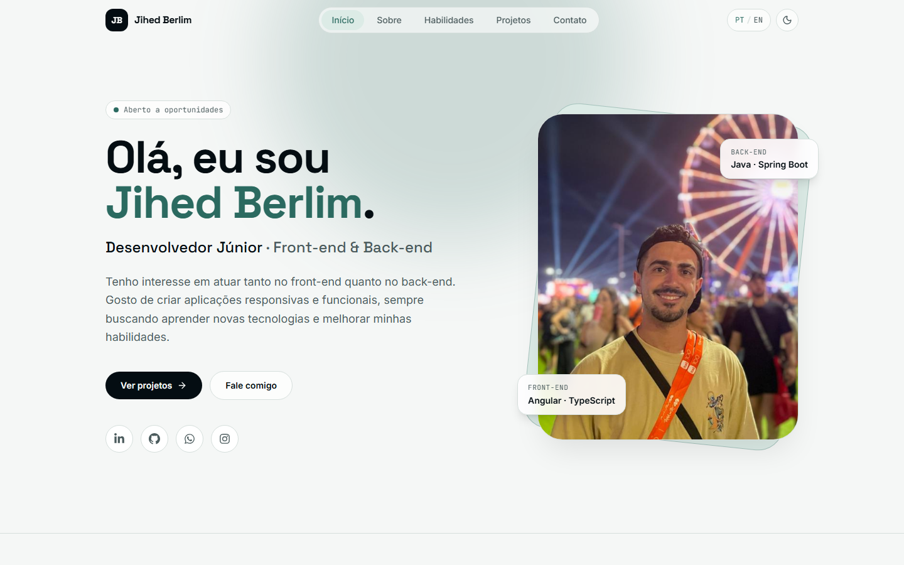
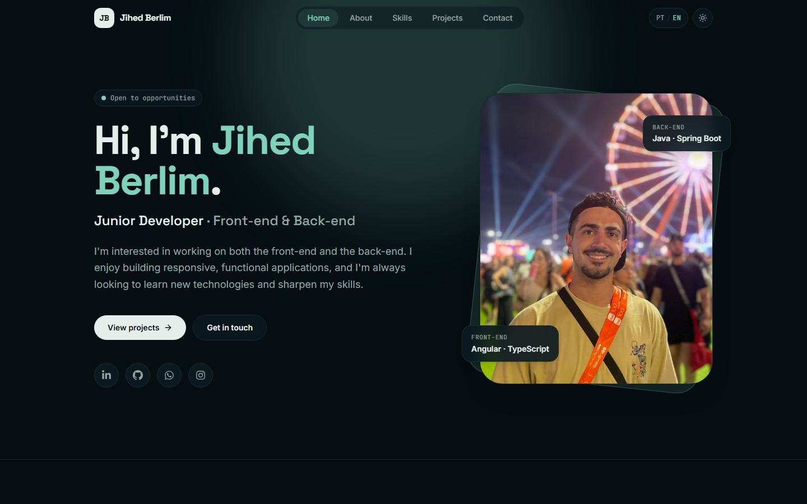
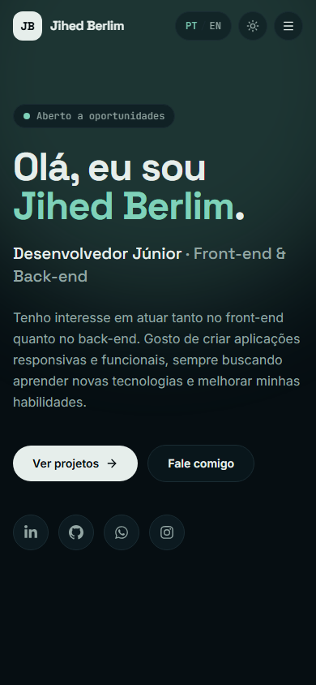
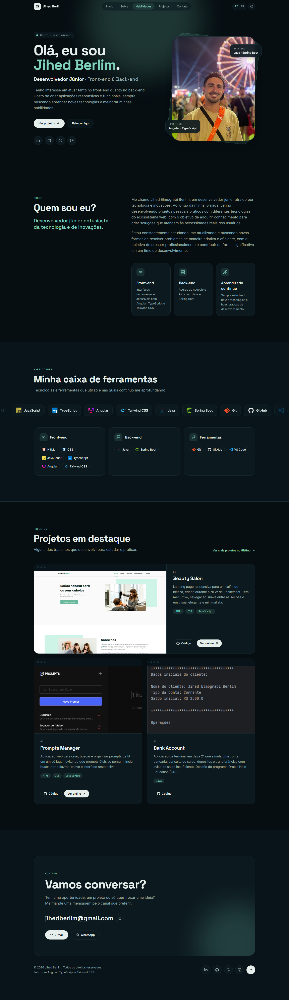

# 🚀 Portfólio | Jihed Berlim

Meu portfólio pessoal, reescrito do zero com **Angular**, **TypeScript** e **Tailwind CSS**.

🔗 **Acesse:** https://jihedeberlim.vercel.app/

<p align="center">
  
</p>

---

## 📸 Telas

| Tema claro | Tema escuro |
| :---: | :---: |
|  |  |

| Versão em inglês | Celular |
| :---: | :---: |
|  |  |

<details>
  <summary><strong>Ver a página inteira</strong></summary>
  <br />
  
</details>

---

## ✨ Funcionalidades

- 🌗 **Tema claro e escuro**: segue a preferência do sistema e lembra a escolha do visitante
- 🌎 **Português e inglês**: troca todos os textos, o título da aba e a mensagem do WhatsApp
- 🧭 **Navbar inteligente**: destaca a seção visível durante a rolagem e vira menu no celular
- 🎠 **Carrossel infinito de habilidades**: pausa ao passar o mouse
- 🗂️ **Projetos em destaque**: o primeiro da lista ganha um card maior
- 📋 **Copiar e-mail** com um clique
- 📱 **Responsivo**: do celular ao monitor grande
- ♿ **Acessível**: navegação por teclado, textos para leitores de tela e respeito à opção "reduzir movimento" do sistema

---

## 🛠️ Tecnologias

| Tecnologia | Para que foi usada |
| --- | --- |
| [Angular 21](https://angular.dev) | Estrutura do site em componentes, com *signals* e sem `zone.js` |
| [TypeScript](https://www.typescriptlang.org) | Tipagem dos dados (projetos, habilidades, traduções) |
| [Tailwind CSS v4](https://tailwindcss.com) | Estilização com classes utilitárias e tema de cores |
| [Vitest](https://vitest.dev) | Testes unitários |
| [Vercel](https://vercel.com) | Hospedagem e deploy automático |

---

## 📂 Estrutura do projeto

```bash
src/
├── app/
│   ├── core/          # Serviços de tema e idioma + todas as traduções
│   ├── data/          # Conteúdo: perfil, habilidades e projetos
│   ├── sections/      # Navbar, Hero, Sobre, Habilidades, Projetos, Contato
│   └── shared/        # Peças reutilizáveis: ícones, títulos, redes sociais, animação
├── index.html
└── styles.css         # Cores, fontes e animações do tema
public/
├── images/            # Foto de perfil e prints dos projetos
└── skills/            # Logos das tecnologias
docs/screenshots/      # Imagens deste README
```

### ✏️ Onde editar cada coisa

| Quero mudar... | Arquivo |
| --- | --- |
| Textos do site (PT e EN) | `src/app/core/translations.ts` |
| Projetos | `src/app/data/projects.ts` (+ print em `public/images/`) |
| Habilidades | `src/app/data/skills.ts` (+ logo em `public/skills/`) |
| E-mail, WhatsApp e redes sociais | `src/app/data/profile.ts` |
| Cores do tema | `src/styles.css` |

---

## ⚙️ Como rodar localmente

**Pré-requisito:** [Node.js 24](https://nodejs.org)

```bash
# 1. Clone o repositório
git clone https://github.com/jihedberlim/main-portfolio.git
cd main-portfolio

# 2. Instale as dependências
npm install

# 3. Rode o projeto (abre em http://localhost:4200)
npm start
```

### Outros comandos

| Comando | O que faz |
| --- | --- |
| `npm test` | Roda os testes unitários |
| `npm run build` | Gera a versão de produção em `dist/portfolio/browser` |

---

## 🧪 Testes

O projeto tem testes unitários com **Vitest** para:

- **App**: verifica se a página monta e se os textos trocam de idioma
- **ThemeService**: verifica a troca entre claro e escuro e se a escolha fica salva
- **I18nService**: verifica a troca de idioma, a escolha do texto certo e o título da aba

```bash
npm test
```

---

## 🙏 Créditos

- Ícones das tecnologias: [Devicon](https://devicon.dev) (MIT)
- Ícones da interface: [Lucide](https://lucide.dev) (ISC)
- Ícones das redes sociais: [Font Awesome Free](https://fontawesome.com) ([CC BY 4.0](https://fontawesome.com/license/free))
- Fontes: [Space Grotesk, Inter e JetBrains Mono](https://fonts.google.com) (Google Fonts)

---

## 📬 Contato

[LinkedIn](https://www.linkedin.com/in/jihed-elmograbi-berlim/) · [GitHub](https://github.com/jihedberlim) · jihedberlim@gmail.com
